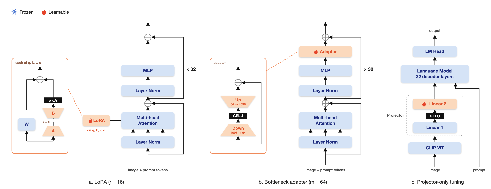

# Llava-domain-adaptation

I'm investigating how well parameter-efficient fine-tuning (PEFT) adapts multimodal language models to different visual domains. This project compares LoRA and adapter-based PEFT on fine-grained datasets, measuring both output quality and compute cost, and asks *where* in the model adaptation helps most: the vision encoder, the vision-to-language projector, or the language model.

Domains:

| Name    | Dataset                                                                        | Classes | Train / Test |
|---------|--------------------------------------------------------------------------------|---------|--------------|
| `birds` | [CUB-200](https://huggingface.co/datasets/cassiekang/cub200_dataset)           | 200     | 5,994 / 5,794 |
| `cars`  | [Stanford Cars](https://huggingface.co/datasets/tanganke/stanford_cars)        | 196     | 8,144 / 8,041 |
| `nabirds` | [NABirds](https://huggingface.co/datasets/zguo0525/nabirds-dataset)          | 404     | 23,929 / 24,633 |

NABirds labels each photo with one of 555 *visual categories*, a species plus a plumage variant such as `Red-winged Blackbird (Female/juvenile)`. The loader collapses these to the 404 species, so the task matches CUB: name the species, not its sex or age. It's ~10GB on the hub, so make sure `HF_HOME` has ~20GB free for the download plus the prepared cache. The original dataset's terms limit it to non-commercial research use.

Backbones (pick one with `--model-id`):

| `--model-id`                  | Params | Status |
|-------------------------------|--------|--------|
| `Qwen/Qwen3-VL-2B-Instruct`   | 2.1B   | current: the method × location grid below |
| `llava-hf/llava-1.5-7b-hf`    | 7.1B   | first round of results, in `reports/lora/` and `reports/adapter/` |

## Methods and locations

Each run picks a method (`--method lora` or `--method adapter`) and where to put it (`--location vision`, `projector` or `lm`). Everything else stays frozen. Sizes are chosen so every cell trains the same number of parameters (~1.6M on Qwen3-VL-2B), which means differences between cells come from placement, not budget.



*Diagram generated using AI*

| Qwen3-VL-2B | Vision encoder | Projector (merger) | Language model |
|---|---|---|---|
| **LoRA** | qkv + proj, r=11: 1,622,016 | fc1 + fc2, r=112: 1,605,632 | q/k/v/o, r=4: 1,605,632 |
| **Adapter** | after each ViT MLP, m=32: 1,598,208 | on the merger output, m=391: 1,603,975 | after each MLP, m=13: 1,548,652 |

- **LoRA** adds a low-rank update `(α/r)·BAx` to existing linear layers. α defaults to 2r, so the update scale stays the same at every rank.
- **Adapter** inserts a new bottleneck block `x + up(GELU(down(x)))` with `up` initialised to zero, so training starts from the unchanged base model. It's the same block at every location; only its width changes.
- **Projector** (`--method projector`, LLaVA only for now) fully fine-tunes the projector's last linear layer instead.

Targets and matched sizes for each backbone live in `src/llava_peft/backbones.py`. Qwen3-VL also has three *DeepStack* paths that carry vision-encoder features straight into the first LM layers, skipping the merger. Vision-encoder edits reach them; projector edits don't.

## Project layout

```
notebooks/                 exploration and scratch work
  00_baseline_sanity_check.ipynb
  01_lora_scratch.ipynb
  02_adapter_scratch.ipynb
src/llava_peft/            reusable code, importable as `llava_peft`
  utils.py                 .env + HF login, device selection (cuda > mps > cpu)
  data/                    dataset registry; every dataset loads as {image, label}
  model.py                 model/processor loading and generation
  backbones.py             per-backbone settings: model class, image size, method targets + matched sizes per location
  methods/                 PEFT methods: lora.py (peft LoRA), adapter.py (bottleneck adapter, projector tuning)
  eval/metrics.py          scoring predictions against labels
scripts/
  train.py                 fine-tune with a method at a location, save the adapter + train_metrics.json
  evaluate.py              generate on a split, score, save predictions + metrics
reports/                   committed metrics and figures from finished runs
results/                   raw run outputs (gitignored)
RUNBOOK.md                 step-by-step checklist for running the Qwen grid
TODO.md                    roadmap
```

Load a dataset from anywhere:

```python
from llava_peft.data import get_dataset

spec = get_dataset("birds")
ds = spec.load("test", limit=100)   # columns: image, label
spec.class_names                    # all label strings
spec.prompt                         # question asked to the model
```

To add a domain, create `src/llava_peft/data/<name>.py` with a `DatasetSpec` and register it in `data/__init__.py`. To add a backbone, add an entry to `BACKBONES` in `backbones.py`.

## Setup

From the project root:

```bash
python3 -m venv .venv
source .venv/bin/activate
python -m pip install --upgrade pip
pip install -r requirements.txt   # also installs this repo in editable mode
```

Qwen3-VL needs a recent `transformers` (tested on 5.18) and `torchvision`, because its processor loads a video processor. If an older venv can't import `Qwen3VLForConditionalGeneration`, run `pip install -U transformers peft`. If it's missing torchvision, install it pinned to the torch you already have, so pip doesn't swap out the CUDA build: `pip install torchvision "torch==<your torch version>"`.

Create a `.env` file in the project root with your Hugging Face token:

```
HF_TOKEN=hf_...
```

## Training

```bash
python scripts/train.py --model-id Qwen/Qwen3-VL-2B-Instruct --method adapter --location vision \
    --epochs 2 --run-name qwen_birds_adapter_vision
```

Leave `--rank`, `--bottleneck-size` and `--image-size` unset to get each cell's matched defaults. Add `--limit 50 --val-fraction 0 --epochs 15` for a quick overfit smoke test. Outputs go to `results/<run-name>/`: `adapter/` (the trained weights) and `train_metrics.json` (config, trainable params, train time, peak memory, loss and validation history).

## Running an evaluation

```bash
# zero-shot
python scripts/evaluate.py --model-id Qwen/Qwen3-VL-2B-Instruct --limit 200 --run-name qwen_zeroshot_smoke

# a trained adapter (pass the same --model-id it was trained with)
python scripts/evaluate.py --model-id Qwen/Qwen3-VL-2B-Instruct \
    --adapter-path results/qwen_birds_adapter_vision/adapter --run-name qwen_birds_adapter_vision_eval
```

Outputs go to `results/<run-name>/`: `predictions.jsonl` (one scored row per example) and `metrics.json` (top-1, timing, peak memory). The primary metric is closed-set top-1: each prediction is mapped to its nearest class name.
